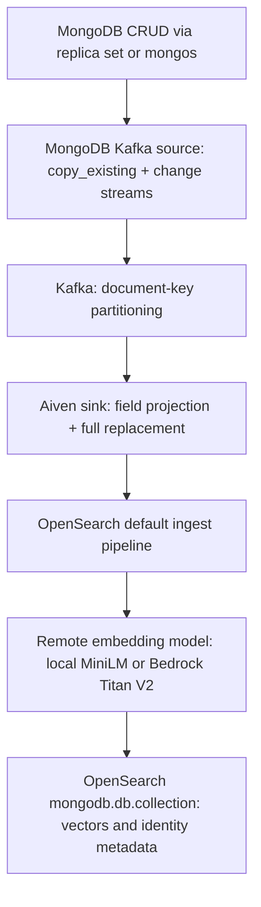
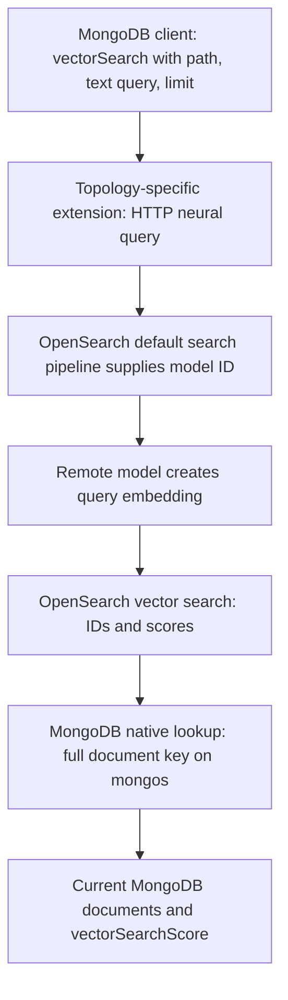

# Architecture

Commands: [README.md](README.md). AWS permissions: [AWS.md](AWS.md).
Optional domain/IAM provisioning: [Terraform HOWTO](terraform/README.md).
The SDK host contract is in the [repository architecture](../../ARCHITECTURE.md);
why this extension exists is in the [repository README](../../README.md).

## Synchronization

There is no custom synchronization consumer. Kafka Connect's source and sink
manage offsets, replay and failures. The sink projects `description`;
OpenSearch converts it to `description_embedding` and removes plaintext before
storage. A global template matches `mongodb.*`, so new synchronized namespaces
inherit the same mapping/pipelines. No MongoDB search indexes are created.

Source configuration uses `startup.mode=copy_existing`, then change streams.
Changes through mongos include both shards. Full-document updates and
replacements produce complete reindexing; deletes become tombstones.

Replica-set records use `_id` as the sink key. Mongos records use the complete
canonical Extended JSON document key, normalized consistently for initial copy
and live changes. The ingest pipeline retains it in `__mongodb.documentKey`.
Serialized identity must not exceed 512 bytes. Shard-key changes and resharding
are unsupported. See [synchronization](SYNC.md).

## Aggregation

Replica sets retain `$_internalSearchIdLookup`. Mongos retains its router-side,
catalog-bound native lookup pipeline and checks the full document key. AWS
does not replace either lookup mechanism. Shared transport signs requests only
when `OPENSEARCH_AWS_REGION` is set. The example owns its ABI wrappers in
`extensions/replica-set/` and `extensions/mongos/`; the SDK and
[OpenSearch core](../../opensearch-extension-core/README.md) are the only shared code.

Signed requests use SigV4 service `es`, cover the exact serialized request body
and optional session token, verify HTTPS certificates, and never follow
redirects. Signed HTTP needs explicit local-only
`OPENSEARCH_AWS_ALLOW_HTTP=true`. Local tests exercise signing but Floci does
not verify signatures. A fixed Rust signature is compared against Botocore,
with tests for URL/body changes and temporary credentials.

## Automatic Setup

`Dockerfile.opensearch` supplies the real OpenSearch 2.19.6 image with a 2 GB JVM
heap. Floci 2.2.0 starts it in the Compose network, outside Compose management.
`run-demo.sh down` calls DeleteDomain and removes any remaining domain container
and volumes before Compose teardown. All mongod caches are 256 MB.

`scripts/setup_local.py` creates the domain, registers an HTTP ML connector,
registers/deploys a remote model and verifies inference. It reuses a deployed
local model on repeated setup. The separate CPU embedding service downloads
`sentence-transformers/paraphrase-MiniLM-L3-v2` and produces normalized
384-dimensional vectors. ML Commons sends batches of strings and receives
batches of float vectors using its built-in default embedding processors.

Only the local cluster enables private-address connectors. The trusted pattern
allows exactly `http://embeddings:8080/embed`. The required credential map has
an unused placeholder; the HTTP service does not authenticate it. Floci's
Bedrock stub is not used for inference.

`scripts/configure.py` loads the ingest/search pipelines and index template from
this example's `config/replica-set/` or `config/mongos/` directory. It supplies the deployed
model ID and vector dimension before applying them. Ingest creates embeddings
and drops plaintext; search uses `neural_query_enricher` to supply the default
model. The template installs both pipelines by default: writes and aggregations
do not pass a model ID. The script writes the endpoint into the extension
manifest on the state volume before MongoDB starts.

This example\'s `Dockerfile.connect` installs MongoDB source and Aiven sink
connectors during build. Registration loads the topology-specific connector
JSON files, adjusts the endpoint/AWS authentication and applies them through
Connect REST. Namespace creation/update/deletion remains native connector
operations; see [SYNC.md](SYNC.md).

`scripts/setup_aws.py` replaces local setup in real AWS mode. It registers an
IAM-role-backed Bedrock connector and Titan Text Embeddings V2 with normalized
512-dimensional float vectors, then installs the same pipeline structure with
512-dimensional mappings. Local and AWS vectors/scores are not equivalent.
Changing dimension on an existing index requires reindexing.

## HA And Limitations

The demo is deliberately single-node at every infrastructure layer. It proves
wiring, not production failover. The extension supports multiple endpoints,
bounded requests and endpoint failover; this example uses one managed domain
endpoint. All endpoints failing returns an error, not partial/stale results.

Kafka ordering is per partition, not across a topic or cluster. Stable document
keys preserve per-document partitioning. Source and sink each use one task;
the sink limits in-flight requests and uses offsets for external versions,
allowing retries without overwriting newer writes. Delivery is at-least-once,
not exactly-once across MongoDB, Kafka and OpenSearch. This is not proof of
arbitrary active-active scaling or topic deletion/recreation safety. Preserve
topics and offsets during recovery.

Search can lag several seconds. A returned MongoDB document may be newer than
its indexed vector. Initial copy is not a global transactional snapshot.
Connector deletion leaves its OpenSearch index intact. Floci does not validate
real AWS IAM, network routing, quotas, TLS enforcement or Bedrock availability.

S3 Vectors is deferred: its OpenSearch integration needs a supported AWS
deployment and is not emulated here. See
[AWS's S3 vector engine requirements](https://docs.aws.amazon.com/opensearch-service/latest/developerguide/s3-vector-opensearch-integration-engine.html).
